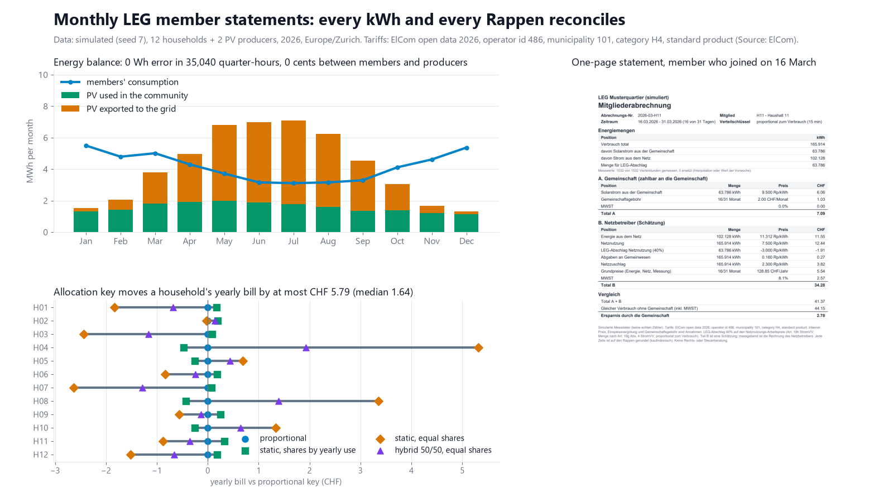
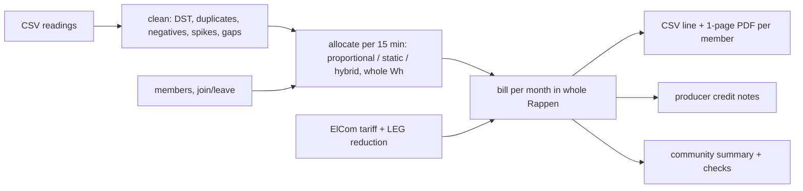

# leg-member-statements

Open-source billing for a Swiss local electricity community (LEG) or virtual self-consumption group (vZEV): 15-minute meter readings in, one-page monthly statements out, with every kWh and every Rappen reconciled.



## What it does

- **Reads 15-minute meter readings** per member (consumption) and per producer (PV feed-in) from a plain CSV (`meter_id,timestamp,kwh`). Timestamps may carry a UTC offset or be naive local time.
- **Cleans the data** and keeps a quality code per interval: duplicate timestamps (identical or conflicting, last row wins), negative and implausible values (above a per-meter kW limit), gaps (linear interpolation up to 2 h, then the same quarter-hour one week earlier), the 23-hour spring day and the 25-hour autumn day (the repeated hour in naive local time is read in file order), off-grid and unparseable rows.
- **Handles membership changes**: members join or leave on any day; energy, base fees and the community fee are counted only for their active days.
- **Allocates community PV** per quarter-hour with three configurable keys: `proportional` to consumption (the rule of Art. 19g para. 4 StromVV), `static` shares (unused shares re-offered to the others), and `hybrid` (a fraction by static shares, the rest by remaining demand). All work in whole Wh with largest-remainder rounding.
- **Prices it**: community internal price, supply energy, grid usage with the **LEG reduction** (40 %, or 20 % when a voltage transformation is needed, Art. 19h StromVV), levies, grid surcharge, base fees, VAT, feed-in remuneration. Tariffs come from ElCom open data. A `vZEV` mode drops grid usage, levies and surcharge on community energy.
- **Writes, per member and month**, one CSV line and a one-page PDF statement in German (A: community part, B: grid-operator part as an estimate, comparison without the community), producer credit notes, and a monthly community summary PDF with the reconciliation checks.
- **No XML parser.** The Swiss metering-data exchange standard (SDAT-CH, based on ebIX) is free to download from the industry association, but its documents are "all rights reserved", reuse other than own use is not permitted without consent, and the XSD files themselves are not published. So I did not build a parser for it; CSV is the input.

Statement labels (German -> English): Mitgliederabrechnung = member statement, Gutschrift Produzent = producer credit note, Verbrauch = consumption, Solarstrom aus der Gemeinschaft = PV from the community, Strom aus dem Netz = energy from the grid, Gemeinschaftsgebühr = community fee, Netznutzung = grid usage, LEG-Abschlag = LEG reduction, Abgaben an Gemeinwesen = levies, Netzzuschlag = grid surcharge, Grundpreise = base fees, MWST = VAT, Ersparnis = saving, Schätzung = estimate, Abstimmung = reconciliation.

## Results

All numbers come from `python -m leg_statements demo` (seed 7). **The meter data is simulated**: 12 households (two with heat pumps, two with EV charging) and 2 PV producers (30 kWp south, 20 kWp east-west), full year 2026 in Europe/Zurich, 35,040 quarter-hours. Household H11 joins on 16 March, H12 leaves after 20 August. Tariffs: ElCom open data 2026 (one grid operator, household category H4, standard product). Internal price 9.5 Rp/kWh, feed-in 8.0 Rp/kWh and community fee CHF 2/month are assumptions.

| check (full year, 162 statements) | result |
|---|---:|
| sum of member allocations minus community energy, every quarter-hour | **0 Wh** |
| sold + exported minus production; community + grid minus consumption, every month | **0 Wh** |
| members paid for community PV vs producers credited (CHF 1,781.81 both) | **0.00 CHF** |
| sum of the 162 printed statements vs community summary (CHF 12,270.98 both) | **0.00 CHF** |
| printed (rounded) lines vs unrounded value, whole year | -0.06 CHF |
| quarter-hours in March / October (DST) | 2,972 / 2,980 |

Energy: production 49,999 kWh, consumption 50,116 kWh, 18,756 kWh used inside the community (37.5 % of the PV), 31,243 kWh exported. Members save CHF 846 in total against the same consumption without a community (median household CHF 67 per year).

**Data quality** (defects injected on purpose into the 490,161 CSV rows): all 28 identical and 28 conflicting duplicates, 14 negative and 14 implausible values were found; 483 quarter-hours had no usable value, 165 were interpolated and 318 replaced by the previous week. No measured value was changed. The estimates carry 24.1 kWh absolute error against the simulated truth (on 78.6 kWh; net -0.5 kWh), 0.02 % of the metered energy, and each statement prints how many of its quarter-hours were estimated.

**Allocation key**, same data, yearly bill per household:

| key | community kWh, biggest household (H04) | total saving, all households | median saving per household |
|---|---:|---:|---:|
| proportional (Art. 19g para. 4) | 3,047 | CHF 845.74 | CHF 67.31 |
| static, shares by yearly consumption | 3,064 | CHF 845.67 | CHF 67.09 |
| static, equal shares | 2,852 | CHF 845.76 | CHF 68.00 |
| hybrid 50/50, equal shares | 2,977 | CHF 845.70 | CHF 67.49 |

The key moves up to 194 kWh of community PV per year between households (H04, -6 %), but a household's yearly bill changes by **at most CHF 5.79** (median CHF 1.64). The reason: the grid-fee reduction follows the ordinance's proportional quantity whatever the internal key, so a moved kWh is only worth the gap between grid energy incl. VAT and the internal price (about 2.7 Rp). With a lower internal price the key matters more; the engine shows it per member.

**Speed** (Windows 10 laptop, 4 logical CPUs, simulated 190 consumers + 10 producers, one year, 7,008,000 readings): cleaning, allocation and billing of all 2,400 member-months took **46.7 s**, the CSV outputs 1.1 s, and the 2,412 PDFs 142 s on 4 processes; **190 s** in total (timestamps passed in memory, CSV file parsing not included). The 14-member demo reads its 490,161-row CSV and bills the year in 12.5 s.

Worked example (statement 2026-03-H11, member who joined on 16 March, 16 of 31 days, checked by hand):

| line | quantity | price | CHF |
|---|---:|---:|---:|
| PV from the community | 63.786 kWh | 9.500 Rp/kWh | 6.06 |
| community fee | 16/31 month | 2.00 CHF/month | 1.03 |
| energy from the grid | 102.128 kWh | 11.312 Rp/kWh | 11.55 |
| grid usage | 165.914 kWh | 7.500 Rp/kWh | 12.44 |
| LEG reduction 40 % | 63.786 kWh | -3.000 Rp/kWh | -1.91 |
| levies / grid surcharge | 165.914 kWh | 0.160 / 2.300 Rp/kWh | 0.27 / 3.82 |
| base fees | 16/31 month | 128.85 CHF/year | 5.54 |
| VAT 8.1 % on part B | | | 2.57 |
| **total A + B** / without community / **saving** | | | **41.37** / 44.15 / **2.78** |

## Quick start

```bash
uv venv .venv --python 3.12
uv pip install --python .venv/Scripts/python.exe -e ".[dev]"     # Linux/macOS: .venv/bin/python
.venv/Scripts/python.exe -m leg_statements demo                   # ~7 min with the 200-member timing; --no-bench: ~1.5 min
.venv/Scripts/python.exe -m pytest -q -p no:asyncio               # 52 tests
```

Own community:

```bash
python -m leg_statements simulate --out my                       # writes my/community.json + my/readings.csv to copy from
python -m leg_statements bill --config my/community.json --readings my/readings.csv \
    --start 2026-01 --end 2026-12 --out out/bill [--key static] [--no-pdf]
python -m leg_statements fetch-tariffs --operator 486 --municipality 101   # refresh the ElCom row (internet)
```

`bill` writes `member_statements.csv` (one line per member and month, kWh with 3 decimals, CHF with 2), `community_summary.csv`, `quality_report.csv`, `checks.json` and `pdf/<month>/<member>.pdf`; it exits with code 2 if any check is not zero. Example files: `examples/`.

Config (`community.json`): `mode` (`LEG` or `vZEV`), `key`, `static_fraction`, `transformation_required` (20 % instead of 40 %), `reduction_basis` (`regulatory` = proportional quantity, or `internal` = the configured key), members (`id`, `role`, `meter`, `share`, `join`, `leave`, `max_kw`) and tariffs (all Rp/kWh excl. VAT, plus `grid_non_reducible_rp` for the part of the grid tariff the reduction must not touch).

## How it works



- Per quarter-hour the community energy is `E = min(production, consumption of active members)`; every key hands out exactly `E` (integer Wh, nobody above its own consumption), the rest is exported and split between producers by their feed-in.
- Every money line is computed once from integer Wh and a price in 1/1000 Rp and rounded half-up to the Rappen; totals are sums of printed lines. Producers receive exactly the Rappen that members paid for community PV, split by sold kWh with largest remainders.
- Part B is what the grid operator would bill: supply energy on the grid share, grid usage on all consumption minus the reduction on the community share, levies and surcharge without reduction (Art. 19h para. 5), base fees from the ElCom data prorated by active days.

## Data sources

- Tariffs: ElCom electricity tariffs 2026 via LINDAS (`https://ld.admin.ch/query`, dataset of electricity prices per grid operator on opendata.swiss, "open use" terms), grid operator id 486, municipality 101, category H4, standard product, retrieved 2026-11-11. Components used: grid-usage working price 7.5, supply energy working price 11.312, levies 0.16, grid surcharge 2.3 Rp/kWh; base fees 36 + 60 CHF/year plus the grid fixed part (0.73 Rp/kWh x 4,500 kWh). Extract: `leg_statements/data/elcom_2026_h4.csv`. Source: ElCom.
- Legal rule: Stromversorgungsverordnung (StromVV, SR 734.71), amendment of 19 February 2025 in force since 2026-01-01 (AS 2025 139, fedlex), read 2026-11-11: Art. 19g para. 4 (15-minute quantity = smaller of community feed-in and consumption, assigned in proportion to consumption), Art. 19h paras. 1, 3 and 5 (40 % / 20 % reduction, items billed without reduction), Art. 19g para. 1 let. b (joins and leaves notified one month ahead to a month end).
- Meter data: simulated (`leg_statements/simulate.py`, seed 7). Not measurements.

## What is not verified yet

- No real utility data exchange: no real meter data, no SDAT-CH / ebIX messages, no comparison with a grid operator's own LEG allocation or invoice. Part B of each statement is an estimate.
- The network-fee reduction is implemented as configured: 40 % / 20 % on the grid-usage **working price** per Art. 19h StromVV. Whether an operator applies it to its whole grid tariff, how it splits out system services and the electricity reserve (`grid_non_reducible_rp`, default 0, which slightly overstates the reduction), and battery rules (Art. 19h para. 4) are not checked. Eligibility (Art. 19e) is not checked.
- With a static or hybrid key, the supply energy on the statement follows the internal key while the ordinance assigns the operator's quantities proportionally; the per-member difference is not reconciled with an operator.
- vZEV mode is a simplification (no grid usage, levies or surcharge on community energy).
- Internal price, feed-in remuneration, community fee and VAT treatment are assumptions. **Not legal or tax advice.**

## Licence

MIT, Copyright (c) 2026 Victor Bonilla. See `LICENSE`.
